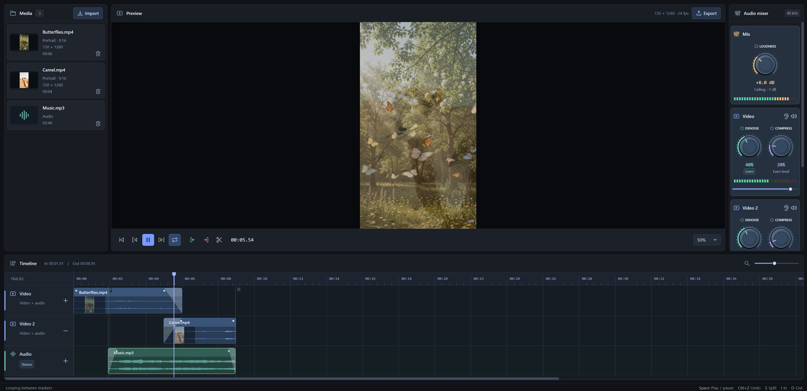

# Bill's Video Editor

This is a simple video editor that runs in the browser. If you just want to trim some clips, glue them together, fix the audio, and export something to upload to YouTube without installing anything or logging in, this might be all you need. If not, feel free to fork it and have your agent personalize it with the features you want.

**Use in your browser:**  
<https://william-kerr.github.io/video-editor>

1. Import local video or audio, then drag it from the media panel onto a matching track.
2. Trim clips, arrange them on the timeline, and adjust the audio in the mixer.
3. Export to download an MP4. Set In and Out markers to export just a selected range.

Files stay in your browser, with no uploads or analytics. Sessions are kept only in memory: closing or reloading discards your edits, and there is no project save/load or recovery. Download your export before leaving.

Use desktop Chrome or Edge for the full timeline. The editor is intended for short edits; each source file must be smaller than 2 GiB, and long or high-resolution exports can exceed browser memory.

## Screenshot

## Running Locally

See [DEVELOPMENT.md](DEVELOPMENT.md) for local setup, architecture and verification. Contributor guidance is in [AGENTS.md](AGENTS.md); project decisions and lessons are recorded in monthly files under [docs/history](docs/history/).

## Background

I was inspired by someone who canceled their Photoshop subscription and built their own app with the features they needed using AI. I periodically subscribe to use Adobe products and thought I'd see if a vibe coded video editor was any good.

### Disclaimer

Although I **despise** vibe slop when it comes to something I'm passionate about, I don't mind vibing personal tools into existence that I don't want to pay for. So, this is just a tool, not a masterpiece.
